# GitHub Artifact Release Assistant

A local web application for preparing Android `.aar` artifact uploads and SDK releases. It provides a React interface backed by a Python server and uses Git and the GitHub CLI (`gh`) for repository operations.

**This project is intended to run on your computer. It is not a GitHub Pages website.** GitHub Pages only serves static files and cannot run this application's Python backend or GitHub CLI commands. The repository contains the source code; it does not automatically publish a website.

## Requirements

- Python 3.10 or later
- Node.js and npm
- Git
- GitHub CLI (`gh`)
- A GitHub account authenticated in the GitHub CLI

Install GitHub CLI if needed, then sign in once:

```powershell
gh auth login
```

## Build and run on Windows

Open PowerShell in the project root (`release_assistant-web`). Build the frontend once:

```powershell
cd frontend
npm install
npm run build
cd ..
```

Start the application:

```powershell
python main.py
```

The application opens in your browser at `http://127.0.0.1:8765`. Keep the terminal open while using it. Press `Ctrl+C` in that terminal to stop the server.

To build the frontend and start the application in one command, run this from the project root:

```powershell
cd frontend
npm start
```

## How it works

1. Upload an Android `.aar` file. The app checks that the file is a ZIP-based AAR archive.
2. Enter artifact information and, when creating a release, answer the release and testing questions.
3. Select a new or existing release branch and review the proposed repository changes.
4. Confirm the operation. The app uses Git and the GitHub CLI to push the artifact and, for the release workflow, create a GitHub release/tag and pull request.

The **Upload Artifact** option uploads the AAR to the selected branch without creating a release/tag or pull request. The **Release / Questionnaire Information** option records release information in the repository `README.md`, creates the GitHub release/tag, and opens a pull request.

## Manage questions

Use **Manage Questions** in the sidebar to add or remove questionnaire items. Custom questions are saved locally in `questions_config.json`. This file is generated on first run and is ignored by Git so that personal question changes are not accidentally committed.

## Project structure

```text
main.py                    Starts the local application and opens the browser
server.py                  Python HTTP server and JSON API
workflow.py                Release workflow and review/confirmation steps
github_cli.py               Git and GitHub CLI helpers
questions.py                Default questions and local question management
report_generator.py         README and pull request content generation
parser.py                   Original local-search helper
config.py                   Local paths and server settings
requirements.txt            Python dependency note
frontend/
  src/                     Readable React components and CSS source
  build.mjs                Builds the frontend into frontend/dist/
  start.mjs                Starts the Python server after the frontend build
  package.json              Frontend scripts and dependencies
```

`frontend/dist/` and `frontend/node_modules/` are generated locally and are not committed. Run the build commands above before starting the app from a fresh clone.
## Architecture

The application uses a React frontend with a Python backend. The backend manages the release workflow and executes Git and GitHub CLI commands to perform repository operations.

## Workflow

```mermaid
flowchart TD
    A(["START<br/>Open Artifact Release Assistant"]) --> B["Select and upload AAR"]
    B --> C{"Is the AAR valid?<br/>Extension and ZIP signature"}
    C -- No --> E["Display validation error"]
    E --> B
    C -- Yes --> D["Enter artifact information<br/>Version · Repository · Source branch"]
    D --> F{"Choose operation"}

    subgraph UP["01 · UPLOAD ARTIFACT"]
        direction TB
        U1["Enter optional upload details"]
        U2["Upload-only workflow"]
        U1 --> U2
    end

    subgraph REL["02 · RELEASE & QUESTIONNAIRE"]
        direction TB
        R1["Complete release information"]
        R2{"Select artifact purpose"}
        R3["Internal Testing"]
        R4["Personal Testing"]
        R5["Production"]
        R6["Answer applicable testing questions"]
        R7["Review questionnaire summary"]

        R1 --> R2
        R2 --> R3
        R2 --> R4
        R2 --> R5
        R3 --> R6
        R4 --> R6
        R5 --> R6
        R6 --> R7
    end

    F -- Upload only --> U1
    F -- Full release --> R1

    U2 --> BR
    R7 --> BR

    BR{"Choose branch strategy"}
    BR -- New branch --> NB["Create branch from source branch"]
    BR -- Existing branch --> EB["Verify remote branch<br/>and check for an open PR"]

    NB --> PREP
    EB --> PREP

    PREP["Prepare repository changes<br/>Add or update AAR<br/>Update README.md for full releases"]
    PREP --> RV["Review proposed changes<br/>and README diff where applicable"]
    RV --> CONF{"Confirm changes?"}

    CONF -- No --> CANCEL["Discard planned changes"]
    CANCEL --> BR

    CONF -- Yes --> PUSH["Commit and push changes<br/>using Git"]

    PUSH --> MODE{"Which operation was selected?"}

    MODE -- Upload only --> UPDONE(["AAR pushed to branch<br/>No release/tag or PR created"])

    MODE -- Full release --> EXIST{"Release/tag already exists?"}

    EXIST -- No --> CREATE["Create GitHub release/tag<br/>Attach AAR as release asset"]
    EXIST -- Yes --> KEEP["Preserve existing release/tag<br/>Do not recreate or move it"]

    CREATE --> PR["Create Pull Request<br/>against the source branch"]
    KEEP --> PR

    UPDONE --> DONE(["WORKFLOW COMPLETE"])
    PR --> DONE

    classDef start fill:#102A43,stroke:#5EEAD4,color:#F0FDFA,stroke-width:2px
    classDef process fill:#172554,stroke:#60A5FA,color:#EFF6FF,stroke-width:1.5px
    classDef decision fill:#3B0764,stroke:#C084FC,color:#FAF5FF,stroke-width:2px
    classDef upload fill:#422006,stroke:#FBBF24,color:#FFFBEB,stroke-width:1.5px
    classDef release fill:#4A1942,stroke:#E879F9,color:#FDF4FF,stroke-width:1.5px
    classDef storage fill:#123047,stroke:#38BDF8,color:#F0F9FF,stroke-width:1.5px
    classDef success fill:#064E3B,stroke:#34D399,color:#ECFDF5,stroke-width:2px
    classDef warning fill:#7F1D1D,stroke:#F87171,color:#FEF2F2,stroke-width:1.5px

    class A,D,BR,PREP,RV,PUSH process
    class C,F,R2,CONF,MODE,EXIST decision
    class U1,U2,UPDONE upload
    class R1,R3,R4,R5,R6,R7,CREATE,KEEP,PR release
    class NB,EB storage
    class DONE success
    class E warning

    style UP fill:#211707,stroke:#F59E0B,stroke-width:2px,color:#FDE68A
    style REL fill:#26132B,stroke:#D946EF,stroke-width:2px,color:#F5D0FE
```




### Main Components

- **React Frontend:** Provides the artifact upload interface, release questionnaire, change review, and question management.
- **Python HTTP Server:** Serves the built frontend and handles API requests from the browser.
- **Release Workflow:** Validates questionnaire answers, prepares branch changes, and coordinates the selected operation.
- **Question Management:** Stores the default and user-added questions in `questions_config.json`.
- **Report Generator:** Creates release documentation for `README.md` and the pull request description.
- **Git and GitHub CLI Helpers:** Handle repository cloning, branch operations, commits, pushes, GitHub releases, and pull requests.
- **Local Workspace:** Stores uploaded AAR files and the working repository clones on the user's computer.

## Operation Behaviour

| Operation | Result |
|---|---|
| **Upload Artifact** | Commits and pushes the AAR to the selected branch. It does not create a GitHub release/tag or pull request. |
| **Release / Questionnaire Information** | Records the AAR and release information, pushes the changes, creates a GitHub release/tag with the AAR attached when applicable, and opens a pull request. |

## Notes

- The Python backend uses the standard library; no third-party Python packages are required.
- Git and the GitHub CLI must be installed and available in `PATH`.
- The app runs on `127.0.0.1` by default, so it is intended for local use.
- GitHub Pages deployment configuration is intentionally not included. Pushing this repository to GitHub only stores the source code; it does not host the application.
